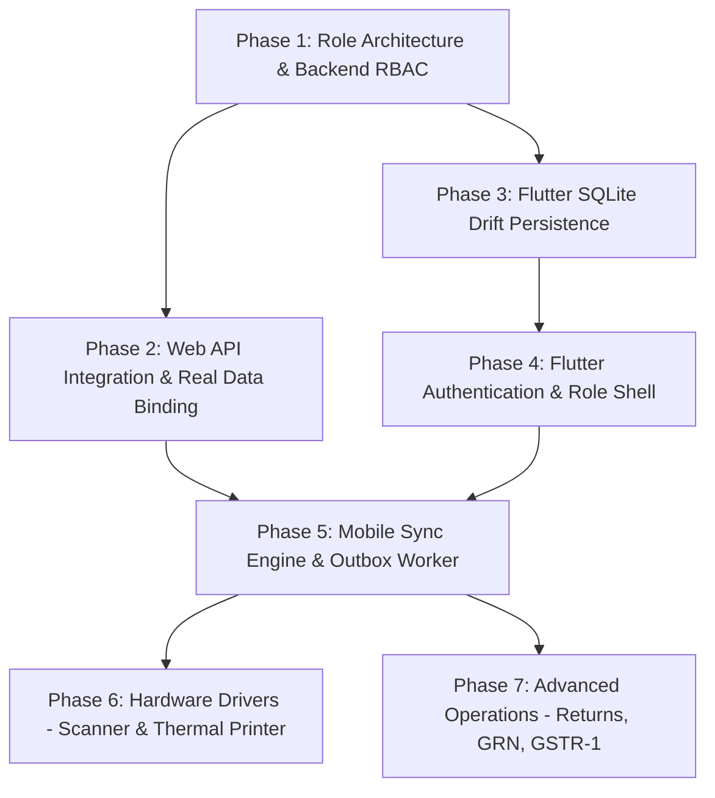

# 13 - Remaining Implementation Roadmap & Execution Plan

**Document Version:** 1.0.0  
**Status:** Implementation Roadmap (Post-Audit Reconciliation)  
**Governing Architecture:** Monorepo Modular Monolith, Offline-First Kirana POS

---

## 1. Architectural Classification of Remaining Work

Based on the baseline established in `docs/12-IMPLEMENTATION-AUDIT.md`, remaining work is divided into four structural categories:

```
┌────────────────────────────────────────────────────────────────────────┐
│                   IMPLEMENTATION WORK CLASSIFICATION                   │
├───────────────────┬───────────────────┬────────────────────────────────┤
│ 1. Complete       │ 2. Extend         │ 3. Correct                     │
│ Wire existing UI  │ Add missing APIs  │ Fix mock abstractions &        │
│ to backend REST   │ to existing domain│ unconstrained database         │
│ endpoints         │ modules           │ columns                        │
├───────────────────┴───────────────────┴────────────────────────────────┤
│ 4. Build from Scratch                                                  │
│ Drift SQLite local DB, Sync Worker, Role Guards, Hardware Transports   │
└────────────────────────────────────────────────────────────────────────┘
```

### 1.1 What Must Be Completed (Wiring Existing Work)
1. **Next.js Web Cashier POS**: Connect `pos-checkout.tsx` to `GET /catalog/products` and wire the checkout action to `POST /billing/sales`.
2. **Next.js Web Store Owner Dashboard**: Connect `admin-dashboard.tsx` to real backend endpoints:
   - Analytics tab -> `GET /operations/reports/daily-sales`
   - Inventory tab & Stock Modal -> `GET /catalog/products` & `POST /catalog/stock/movements`
   - Khata tab & Repayment Modal -> `GET /operations/customers` & `POST /operations/customers/:id/payments`
   - Shifts tab -> `GET /operations/shifts`
   - Devices tab -> `GET /commercial/devices` & `GET /commercial/subscription`
3. **Flutter Kirana POS UI**: Replace in-memory mock products in `pos_screen.dart` with local SQLite records populated from the catalog repository.

### 1.2 What Must Be Extended
1. **Backend Billing Module**: Implement sales return and credit note creation (`POST /billing/returns`) with original invoice linkage (Rule 10).
2. **Backend Catalog Module**: Add product update (`PATCH /catalog/products/:id`) and category hierarchy.
3. **Backend Operations Module**: Add customer creation UI support, statement generation, and shift cash-drop logs.
4. **Backend Sync Module**: Add conflict resolution policies for concurrent price and inventory movements.
5. **OpenAPI Specification**: Sync all Swagger endpoint schemas back into `packages/api-contracts/openapi/openapi.yaml`.

### 1.3 What Must Be Corrected
1. **Unconstrained Role Column**: Migrate `tenant_memberships.role` from free-text `VARCHAR(64)` to a typed role enum (`owner`, `branch_manager`, `cashier`, `inventory_staff`, `accountant`) and attach an optional `branch_id` foreign key.
2. **TenantGuard Scope**: Add a typed `PermissionsGuard` and `@RequirePermissions(...)` decorator to prevent privilege escalation across tenant members.
3. **Simulated Persistence**: Replace the mock `Future.delayed(150ms)` in `offline_billing_service.dart` with an actual atomic SQLite transaction.

### 1.4 What Must Be Built from Scratch
1. **Flutter Local SQLite Database (Drift Engine)**: Schema definitions for products, categories, customers, invoice ledger, stock ledger, and sync outbox.
2. **Flutter Sync Engine (Outbox Worker & Delta Puller)**: Background service using Dio to pull catalog deltas and push queued outbox operations.
3. **Mobile Authentication & Session Manager**: Login screen, PIN authentication, JWT token storage in `flutter_secure_storage`, and tenant/branch selector.
4. **Role-Driven Mobile Navigation Shell**: Dynamic navigation showing only the screens permitted for the user's role and assigned branch.
5. **Hardware Transports**:
   - Camera barcode scanner via `mobile_scanner`.
   - Bluetooth / USB ESC/POS thermal printer transport driver.

---

## 2. Dependency Graph & Sequencing

The implementation sequence must strictly follow architectural dependencies:



---

## 3. Phased Implementation Roadmap

### Phase 1: Security, Role Architecture & Backend RBAC
**Goal:** Guarantee strict access control and branch-level boundaries on all backend APIs.

#### Tasks:
1. Update `packages/shared-types` with canonical `Role` and `Permission` enums.
2. Update `packages/validation` with membership DTO validation for roles.
3. Create database migration: Add `branch_id` (nullable) to `tenant_memberships`, create index on `(tenant_id, user_id, branch_id)`.
4. Implement `@RequirePermissions(...permissions: Permission[])` decorator.
5. Implement NestJS `PermissionsGuard` verifying user membership, role, and branch context against requested endpoint.
6. Apply `@RequirePermissions` across all controllers (`catalog`, `billing`, `operations`, `commercial`, `sync`).
7. Add comprehensive unit tests in `apps/backend/src/tenants/guards/permissions.guard.spec.ts` covering IDOR and privilege escalation rejection.

#### Acceptance Criteria:
- Cashier role cannot call product creation, stock adjustment, device registration, or shift reconciliation endpoints (receives HTTP 403).
- Store Owner can execute all business and billing endpoints across all branches.
- Branch Manager can only manage and view records for their assigned `branch_id`.
- Zero test regressions in existing 11 test suites.

---

### Phase 2: Web API Integration & Real Data Binding (COMPLETED)
**Goal:** Transition the Next.js web application from mock state to live database interactions.

#### Completed Deliverables:
1. Created typed API client in `apps/web/src/lib/api-client.ts`.
2. Implemented web authentication flow with HttpOnly cookies, session management, and RBAC role gating.
3. Connected Cashier POS (`pos-checkout.tsx`) to live catalog, barcode scanning, split payments, and backend billing (`POST /billing/sales`).
4. Connected Store Owner Dashboard (`admin-dashboard.tsx`) to live daily sales reports, customer Khata, shifts, and devices.

---

### Phase 3: Store Owner Web Management, Inventory & Khata Operations (IN PROGRESS)
**Goal:** Complete the backoffice operational management suite for Store Owners and Inventory Managers with strict financial and inventory invariants.

#### Sub-Phase 3A: Product Catalogue & SKU Management (COMPLETED)
- Database migration `1730440000000-EnhanceProductsWithGstAndVariants.ts`:
  - Added `gst_rate_percent` and `package_size` columns to `products`.
  - Added partial unique index `UQ_products_tenant_barcode_active` on `(tenant_id, barcode_primary)`.
- Backend catalog service and controller with `@RequirePermissions`:
  - SKU & Barcode uniqueness validation per tenant.
  - Price constraint enforcement (`sellingPrice <= mrp`).
  - Atomic opening stock ledger entry generation (`movementType: OPENING`, `sourceType: 'opening_stock'`).
  - Unit and category management endpoints.
- Store Owner UI:
  - Product Catalogue table with live stock balance, variant tags, cost, price, and MRP.
  - Add/Edit Product modals with GST slab selectors and opening stock ingestion.

#### Sub-Phase 3B: Purchase Orders, GRN & Supplier Management (COMPLETED)
- Database migration `1730450000000-CreatePurchaseOrdersAndGrnTables.ts`:
  - Created `purchase_orders` and `purchase_order_lines` tables with `purchase_order_status_enum` ('draft', 'ordered', 'received', 'cancelled').
- Backend Procurement Services:
  - Supplier CRUD (`GET`, `POST`, `PUT`, `DELETE /catalog/suppliers`).
  - Purchase Order CRUD (`POST /catalog/purchases/orders`, `GET /catalog/purchases/orders`, `PATCH /catalog/purchases/orders/:id/status`).
  - Inward Goods Received Notes (GRN) (`POST /catalog/purchases/orders/:id/receive`):
    - Atomically writes immutable `stock_ledger` entries with `movement_type: purchase` and `source_type: purchase_order`.
    - Updates branch `stock_balances` perpetual on-hand projection.
    - Updates PO line `quantityReceived` and marks status `RECEIVED` once all quantities are fulfilled.
- Store Owner UI:
  - Dedicated **🚚 Suppliers** view with vendor search, registration, and editing modals.
  - Dedicated **📦 Purchase Orders & GRN** view with order summary cards, line item summaries, and status badges.
  - Interactive "➕ Create Purchase Order" modal with line item builder and live GST calculation.
  - "📥 Receive Goods (GRN)" modal enabling full or partial shipments inward to the stock ledger.

#### Sub-Phase 3C: Customer Khata Statements, Repayments & Full Audit History (COMPLETED)
- Database migration `1730460000000-EnhanceCustomerLedgerAndStatements.ts`:
  - Added `payment_method` (`VARCHAR(32)`) and `created_by` (`UUID`) columns to `customer_ledger`.
  - Added unique partial index `UQ_customer_ledger_tenant_idempotency` on `(tenant_id, idempotency_key)` to enforce idempotency at the database engine level.
  - Added index `IDX_customer_ledger_occurred` on `(tenant_id, customer_id, occurred_at)` for high-performance chronological statement queries.
- Backend Khata Services & Integrations:
  - Statement generation (`GET /operations/customers/:id/statement`):
    - Computes period opening balance from all debits and credits prior to statement start.
    - Computes chronological running balance for every ledger transaction.
    - Computes available credit, utilization percentage, credit status (`healthy`, `near_limit`, `exceeded`, `no_credit`).
    - Standard FIFO debt ageing analysis categorizing unpaid balances into `0-30 Days`, `31-60 Days`, `61-90 Days`, and `90+ Days (Overdue)`.
  - Credit Limit Management (`PATCH /operations/customers/:id/credit-limit`):
    - Sets and updates customer credit limits with mandatory reason and immutable audit log via `AuditService`.
  - Multi-tender Repayments (`POST /operations/customers/:id/payments`):
    - Supports `cash`, `upi`, `card`, `bank_transfer`.
    - Idempotency protection via unique idempotency keys.
    - Rejects repayment amounts greater than outstanding balance.
    - Atomically updates customer balance and receivables ledger.
  - POS Credit Sale Integration (`BillingService.createSale`):
    - Tender via `PaymentMethod.CREDIT` requires registered customer.
    - Validates credit limit (`currentBalance + creditAmount <= creditLimit`).
    - Atomically creates `CustomerLedgerEntity` (`INVOICE_DEBIT`, `paymentMethod: 'credit'`) and increments customer's `currentBalance`.
- Store Owner Web UI (`admin-dashboard.tsx`):
  - Top Khata KPI Summary cards: Total Receivables Owed, Active Debtors, Total Credit Limit Extended, Accounts Over Limit.
  - Customer Accounts table with instant search, credit limit, balance, available credit, and status badges.
  - "➕ New Customer" modal for quick counter customer onboarding.
  - "📜 View Statement" modal displaying customer info, FIFO ageing breakdown, date filters, summary pills, and chronological transaction timeline with running balances.
  - "🖨️ Print Statement" and "📥 Export CSV" actions for customer account reconciliation.
  - "💵 Receive Repayment" modal supporting Cash, UPI, Card, and Bank Transfer with client-side balance validation.
  - "✏️ Edit Credit Limit" modal with mandatory audit reason.

#### Sub-Phase 3D: GST Sales Reports (GSTR-1 & GSTR-3B Summaries) (COMPLETED ✅)
- **Database & Domain Entities**:
  - Added `gstin VARCHAR(15)` to `branches`.
  - Added `customer_gstin_snapshot VARCHAR(32)` and `place_of_supply VARCHAR(10)` to `invoices`.
  - Created `supplier_invoices` (Vendor Tax Invoices) with composite unique key `(tenant_id, supplier_id, supplier_invoice_number)`.
  - Created `supplier_invoice_lines` with HSN code, taxable value, GST rate percent, and CGST/SGST/IGST breakdown.
  - Snapshot validation: Invoices snapshot customer GSTIN and POS (state code) at time of sale; reporting queries immutable invoice line snapshots rather than mutable product configurations.
- **Tax Reporting Engine & Backend Services (`GstReportingService`)**:
  - `GSTR-1 Preparation` (`GET /billing/reports/gst/gstr-1`):
    - Table 4: B2B Invoices for recipients with registered GSTINs.
    - Table 5: B2C Large for inter-state unregistered sales > ₹2,50,000.
    - Table 7: B2C Small aggregated by `(place_of_supply, rate, supply_type)`.
    - Table 12: HSN Summary grouped by HSN snapshots with UQC, quantities, taxable values, and taxes.
    - Table 13: Document Summary with serial numbers, issued, and cancelled counts.
    - Statutory disclaimer and downloadable JSON and CSV export formats.
  - `GSTR-3B Summary Return & ITC Reconciliation` (`GET /billing/reports/gst/gstr-3b`):
    - Table 3.1: Details of Outward Supplies & Inward Supplies liable to Reverse Charge.
    - Table 3.2: Inter-state supplies to unregistered persons by POS.
    - Table 4: Eligible & Ineligible Input Tax Credit (ITC) queried from verified `supplier_invoices`:
      - 4(A)(5) All Other ITC (from verified registered vendor tax invoices).
      - 4(B) Ineligible ITC (Section 17(5) blocked credits, unregistered vendors).
      - 4(C) Net Eligible ITC.
    - Statutory Set-off Engine: IGST liability settled against IGST credit first, then CGST/SGST liability, calculating accurate Net Tax Payable in Cash.
    - Accountant audit warnings & exceptions banner.
  - `Sales Tax Register` (`GET /billing/reports/gst/sales-register`):
    - Invoice-by-invoice sales and tax audit register.
  - `Supplier Invoices (Vendor Bills)` (`POST /billing/supplier-invoices`, `GET /billing/supplier-invoices`):
    - Statutory proof under Section 16(2) required to claim and reconcile ITC.
- **Web UI & Store Owner Dashboard (`gst-reports-view.tsx`, `admin-dashboard.tsx`)**:
  - Dedicated "📑 GST Reports & Returns" tab in store owner dashboard.
  - Return Period selector (Month / Year) and Branch filter (Consolidated vs Branch-specific).
  - Sub-views: GSTR-1 Outward Supplies, GSTR-3B Summary Return, Sales Register, and Vendor Tax Invoices.
  - GSTR-1 tables: B2B (Table 4), B2CL (Table 5), B2CS (Table 7), HSN (Table 12), and Documents (Table 13).
  - GSTR-3B summary tables: Table 3.1 Outward supplies, Table 4 ITC, Tax Settlement Reconciliation & Net Cash Payable.
  - Interactive Actions: "📥 Download GSTR-1 JSON", "📥 Export GSTR-1 CSV", "📥 Export GSTR-3B CSV", "🖨️ Print Summary", and "➕ Record Vendor Bill" modal.
- **Verification & Automated Tests**:
  - `gst-reporting.service.spec.ts` (5/5 tests passed).
  - `gst-reports-view.test.tsx` (4/4 tests passed).
  - `page.test.tsx` (29/29 tests passed).
  - Monorepo TypeScript typecheck: 5/5 projects passed with 0 errors.
  - Live end-to-end verification script `test-gst.ps1` passed against local PostgreSQL 18.6 and NestJS server.

#### Pre-Phase 3E: Production Data Quality & GST Compliance Corrections (COMPLETED ✅)
- **Section A: Customer Data Quality & POS Walk-in Default**:
  - Default walk-in checkout without creating extraneous customer database profiles.
  - Phone normalization supporting 10-digit Indian numbers, `+91`, `0091`, and leading zeros.
  - Customer duplicate phone conflict protection (HTTP 409 `CUSTOMER_PHONE_EXISTS`) with user override `confirmDuplicate: true`.
  - Direct POS customer onboarding modal with live duplicate detection and 1-click select of existing matches.
  - Customer lifetime history dossier endpoint (`GET /operations/customers/:id/history`) providing purchases value, invoice counts, repayments, and chronological ledger movements.
  - Controlled Customer Merging (`POST /operations/customers/:id/merge`):
    - Reassigns invoices and customer ledger records in a PostgreSQL transaction.
    - Recalculates target customer's current balance from complete transaction history.
    - Soft-deactivates source record (`[MERGED into ...]`) and strictly preserves all financial records (Rule 9).
    - Records immutable audit log event via `AuditService`.
  - Development data isolation: seed scripts guarded against execution in production (`NODE_ENV === 'production'`); safe dev test customer cleanup endpoint that refuses to delete customers with transactions.
- **Section B: GST Compliance Correction (Notification No. 12/2024-Central Tax)**:
  - Verified and implemented date-dependent B2CL reporting threshold:
    - Prior to 1 August 2024: ₹2,50,000.
    - On or after 1 August 2024: reduced to **₹1,00,000** for inter-state B2C supplies in Table 5.
    - Intra-state B2C supplies of any amount strictly remain in Table 7 (B2CS).
- **Section C: GSTIN Configuration**:
  - Eliminated hardcoded demo GSTIN fallbacks (`27AABCK1234F1Z5`). Returns `'UNREGISTERED'` with statutory warning banners when unconfigured.
  - Added branch update endpoint (`PATCH /tenants/:tenantId/branches/:branchId`) validating 15-character GSTIN format and state code prefix matching.
  - Added "🏢 Branches & GSTIN" configuration tab in Web Admin Dashboard.
- **Section D: Verification & Automated Tests**:
  - `gst-reporting.service.spec.ts` (5/5 tests passed).
  - `operations.service.spec.ts` (13/13 tests passed).
  - `page.test.tsx` (29/29 tests passed).
  - Monorepo typecheck: 5/5 packages green with 0 errors.

#### Sub-Phase 3E: Multi-Branch Stock Transfers & Reconciliation (COMPLETED ✅)
- **Database & Entities**:
  - Created migration `database/migrations/1730480000000-CreateStockTransfersTables.ts` defining `stock_transfers_status_enum` (`draft`, `in_transit`, `received`, `cancelled`), `stock_transfers`, and `stock_transfer_lines` tables with indexes on `(tenant_id, transfer_number)`, source and destination branch foreign keys, and cascading line items.
  - Created TypeORM entities `StockTransferEntity` and `StockTransferLineEntity` under `apps/backend/src/catalog/entities/`.
  - Added `StockTransferStatus` enum in `@pos/shared-types`.
- **Backend Domain Services & Controller (`CatalogService`, `CatalogController`)**:
  - `createStockTransfer` (`POST /catalog/transfers`):
    - Validates source and destination branches are distinct and belong to tenant.
    - Prevents empty manifests; snapshots item costs and verifies product active status.
    - Optional `autoDispatch` flag for immediate transit transitions.
  - `dispatchStockTransfer` (`POST /catalog/transfers/:id/dispatch`):
    - Requires transfer in `DRAFT` status and user `STOCK_TRANSFER` permission.
    - Atomically checks stock availability at source branch for each line item.
    - Inserts `stock_ledger` entries with `movement_type = TRANSFER_OUT` (negative delta).
    - Decrements perpetual `stock_balances` in origin branch.
    - Updates transfer status to `IN_TRANSIT` with `dispatched_at` and `dispatched_by`.
    - Generates immutable `STOCK_TRANSFER_DISPATCHED` audit log entry.
  - `receiveStockTransfer` (`POST /catalog/transfers/:id/receive`):
    - Requires transfer in `IN_TRANSIT` status.
    - Compares dispatched quantities vs received quantities per line.
    - Detects variances: flags `hasDiscrepancy: true`, computes `discrepancyQuantity`, and mandates discrepancy reason if under/over received.
    - Atomically increments destination branch `stock_balances` by actual quantity received with `stock_ledger` movement `TRANSFER_IN`.
    - Updates transfer status to `RECEIVED` with `received_at` and `received_by`.
    - Emits `STOCK_TRANSFER_RECEIVED` audit log event with detailed discrepancy flag.
  - `cancelStockTransfer` (`POST /catalog/transfers/:id/cancel`):
    - If transfer was already `IN_TRANSIT`, automatically posts stock reversal movements (`TRANSFER_IN`) back to source branch to restore inventory.
    - Updates status to `CANCELLED` and emits `STOCK_TRANSFER_CANCELLED` audit log.
  - `getStockTransfers` / `getStockTransferById` (`GET /catalog/transfers`):
    - Supports branch routing filters (`branchId`, `sourceBranchId`, `destinationBranchId`), status filters, and pagination using TypeORM `findAndCount`.
- **Store Owner Web UI (`apps/web/src/features/inventory/`)**:
  - Modern Shadcn UI with Tailwind design tokens:
    - `stock-transfers-view.tsx`: KPI summary cards (Total Transfers, In-Transit, Received, Discrepancies), filters by status and branch, registers table, manifest preview, action triggers.
    - `create-transfer-modal.tsx`: Origin/destination branch selectors with same-branch guard, line item builder, real-time stock-on-hand preview.
    - `receive-transfer-modal.tsx`: Manifest reconciliation table with Dispatched vs Received comparison, automatic variance calculation, mandatory discrepancy note when variance exists.
    - `transfer-details-modal.tsx`: Audit timeline (Draft -> Dispatched -> Received/Cancelled), full item manifest with discrepancy badges, audit details.
  - Integrated under Store Owner Dashboard > Inventory Management > subtab "🔄 Branch Transfers".
- **Verification & Automated Tests**:
  - Backend unit tests `apps/backend/src/catalog/catalog.service.spec.ts` (31/31 passed).
  - Web unit tests `apps/web/src/features/inventory/__tests__/stock-transfers-view.test.tsx` (7/7 passed).
  - Monorepo typecheck: 5/5 packages green with 0 errors (`pnpm -r typecheck`).
  - Web production build passed (`pnpm --filter @pos/web run build`).
  - Live E2E script `test-transfers.ps1` validated against PostgreSQL 18.6 daemon:
    - Step 1: Owner authentication and branch resolution.
    - Step 2: Transfer Order creation (Draft).
    - Step 3: Dispatch reducing origin stock by 10 units (`TRANSFER_OUT`).
    - Step 4: Discrepancy receiving (8 of 10 received) incrementing destination stock by 8 units (`TRANSFER_IN`) and flagging discrepancy.
    - Step 5: Cancellation of in-transit transfer reversing 5 units back to origin stock.
    - Step 6: REST API querying with pagination and status filters.

---

### Phase 4: Flutter Local Persistence (Drift SQLite Engine)
**Goal:** Implement true offline persistence compliant with Rule 13 (Local write must complete before success).

#### Tasks:
1. Configure Drift (`apps/mobile/lib/core/database/`):
   - Define tables: `LocalProducts`, `LocalCategories`, `LocalCustomers`, `LocalInvoices`, `LocalInvoiceLines`, `LocalPayments`, `LocalStockLedger`, `SyncOutbox`.
2. Generate Drift code using `build_runner`.
3. Implement `LocalBillingRepository`:
   - Execute sale in a single SQLite transaction:
     - Insert `LocalInvoices`.
     - Insert `LocalInvoiceLines` with HSN/GST snapshots.
     - Insert `LocalPayments`.
     - Insert `LocalStockLedger` deduction movement.
     - Insert `SyncOutbox` entry with UUID, timestamp, and payload.
4. Refactor `apps/mobile/lib/core/services/offline_billing_service.dart` to use `LocalBillingRepository`.
5. Add unit and widget tests verifying that SQLite transaction commits successfully before receipt is returned.

#### Acceptance Criteria:
- Sale creation writes to local SQLite database atomically.
- Device can complete full billing workflow completely detached from network.
- Outbox queue accurately records every offline sale with payload for future sync.

---

### Phase 4: Flutter Authentication & Role-Based Navigation
**Goal:** Support single Flutter binary with role-based interfaces for Owner, Branch Manager, Cashier, Inventory Staff, and Accountant.

#### Tasks:
1. Create Flutter `AuthRepository` with Dio HTTP client connecting to backend `/api/v1/auth/login`.
2. Store tokens and user profile securely using `flutter_secure_storage`.
3. Create Mobile Login screen with email/password and quick PIN unlock.
4. Create Tenant and Branch Selector screen for multi-branch users.
5. Create `RoleNavigationShell`:
   - **Store Owner**: Bottom navigation bar with Kirana POS, Store Analytics, Stock Ledger, Customer Khata, and Settings.
   - **Cashier**: Direct full-screen touch POS billing + Shift Open/Close.
   - **Inventory Staff**: Stock receive, stock audit, barcode search, low-stock alerts.
   - **Accountant**: Financial reports, GST breakdown, customer credit statements.
6. Write Flutter widget tests for role navigation gating.

#### Acceptance Criteria:
- Logging in as Store Owner unlocks both mobile billing and complete management views.
- Logging in as Cashier restricts interface strictly to POS billing and register shifts.
- Logging out clears secure tokens and resets state cleanly.

---

### Phase 5: Mobile-to-Backend Sync Engine
**Goal:** Bi-directional sync between offline Flutter devices and central NestJS server.

#### Tasks:
1. Implement `SyncWorker` in Flutter:
   - **Delta Pull**: Periodically calls `GET /api/v1/tenants/:tenantId/sync/pull?cursor=...`.
   - Commits pulled products, categories, and customer balances into local Drift database inside a transaction; advances cursor only on commit.
   - **Outbox Push**: Reads pending operations from `SyncOutbox`, batches them, and posts to `POST /api/v1/tenants/:tenantId/sync/push`.
   - On HTTP 200/201, marks outbox entries as `SYNCED` and stores server acknowledgment.
2. Implement connectivity listener (`connectivity_plus`) to trigger auto-sync when online.
3. Add Sync Status UI indicator showing pending outbox count, last sync timestamp, and retry button.

#### Acceptance Criteria:
- Sales made offline sync to PostgreSQL backend within 5 seconds of reconnecting.
- Duplicate sync pushes return idempotent success without duplicating sales or stock movements.
- Updated product prices on backend reflect on mobile after next sync pull.

---

### Phase 6: Hardware Integration (Scanner & Thermal Printer)
**Goal:** Field-ready Kirana hardware workflows.

#### Tasks:
1. **Barcode Scanner**:
   - Integrate `mobile_scanner` for camera-based continuous barcode scanning.
   - Support USB/Bluetooth keyboard-wedge barcode scanners with hardware key-event listener.
2. **Thermal Receipt Printing**:
   - Implement ESC/POS raw socket transport (TCP port 9100 for network printers) and Bluetooth SPP driver for handheld mobile printers.
   - Decouple printer from billing: printer failure logs error, does not abort posted sale (Rule 14).
   - Add "Reprint Last Receipt" button on mobile and web.

#### Acceptance Criteria:
- Scanning a barcode adds product to cart in <100ms.
- Receipt prints cleanly on 58mm and 80mm ESC/POS thermal printers.
- Printer out-of-paper does not duplicate or roll back transactions.

---

### Phase 7: Advanced Operations & Compliance
**Goal:** Complete retail lifecycle and statutory requirements.

#### Tasks:
1. Implement Sales Returns and Credit Notes (`POST /billing/returns`) with original invoice linkage and resellable vs damaged stock sorting (Rule 10, Rule 15).
2. Implement Goods Receipt Note (GRN) and Purchase Inward workflow.
3. Implement GSTR-1 export formatters (B2B, B2CS, B2CL, HSN Summary) in JSON and CSV.
4. Build Super Admin portal in web app for multi-tenant monitoring.

#### Acceptance Criteria:
- Returns link to original invoices and generate valid credit note numbers.
- GSTR-1 summaries match sum of posted invoice line items to the exact paisa.

