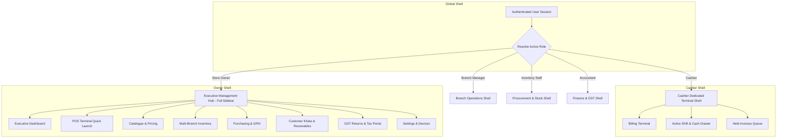

# 17 — UX Navigation Architecture & Role-Based Workflows

**Document Version:** 1.0.0  
**Status:** Approved Target UX Specification  
**Governing Principle:** Role-Driven Progressive Disclosure (Simplicity for Cashiers, Mastery for Owners)  

---

## 1. Information Architecture Overview

The modernized platform departs from the current binary switcher (`POS` vs `Admin`) and establishes a **Role-Tailored Navigation Hierarchy**.

---

## 2. Role-Based Navigation Specifications

---

### 2.1 Role 1: Cashier (Counter Speed & Zero Distraction)
**Cashier Primary Goal:** Ring up items as fast as humanly possible, calculate change accurately, accept cash/UPI, and print receipt.

- **Shell Type:** Dedicated Full-screen POS Terminal (No complex sidebar).
- **Header Elements (Compact 44px):**
  - Branch Identifier (`Main Store - Andheri West`).
  - Active Cashier Name (`Suresh Cashier`).
  - Active Shift Indicator (`Shift #104 • Opened 09:00 AM`).
  - Quick Action Buttons: `Held Bills (3)`, `Day Total (₹14,250)`, `End Shift`.
- **Primary Viewport:**
  - **Left 60%**: High-contrast touch product grid with barcode wedge listener and instant search bar.
  - **Right 40%**: Continuous live bill with instant quantity edit, item discount, grand total, and large payment triggers.
- **Hidden Features:** Inventory valuation, purchase orders, vendor invoices, tax liability calculations, and tenant-wide settings are completely hidden.

---

### 2.2 Role 2: Store Owner (Complete Business Control)
**Owner Primary Goal:** Complete oversight across sales velocity, gross margins, stock balances, vendor payables, customer debt, and tax filings.

- **Shell Type:** Left Collapsible Sidebar (240px expanded / 64px icon-only collapsed) + Dynamic Content Pane.
- **Sidebar Structure:**
  - **Store Switcher:** Business logo, active store name, branch dropdown.
  - **Core Operations:**
    - `📊 Executive Dashboard` (Daily revenue, profit margins, top items, cash balance)
    - `🛒 POS Terminal` (Direct 1-click jump to full cashier billing)
  - **Catalogue & Inventory:**
    - `🏷️ Products & SKUs` (Catalog, barcodes, pricing, HSN)
    - `⚖️ Stock Balances` (Perpetual inventory, stock adjustments, branch transfers)
    - `🚚 Purchasing & GRN` (Suppliers, purchase orders, inward goods receiving)
  - **Relationships & Debt:**
    - `📒 Customer Khata` (Customer directory, debt ledger, repayments, statement timeline)
  - **Compliance & Financials:**
    - `📑 GST & Taxes` (GSTR-1, GSTR-3B summaries, sales register, vendor ITC bills)
    - `⏱️ Cashier Shifts` (Daily shift reconciliations, cash shortages/overages)
  - **System Administration:**
    - `⚙️ Store Settings` (Branches & GSTIN, POS Devices, Employee Roles, Subscription Plan)
  - **Footer:** User avatar, role badge, quick help, and logout trigger.

---

### 2.3 Role 3: Branch Manager (Branch-Scoped Operational Autonomy)
**Manager Primary Goal:** Oversee branch stock levels, manage store cashiers, record stock adjustments, and receive inward stock.

- **Shell Type:** Left Sidebar (Branch-Scoped).
- **Navigation Structure:**
  - `📊 Branch Overview` (Branch-specific sales, cashier breakdown)
  - `🛒 POS Terminal` (Cashier billing)
  - `🏷️ Product Catalogue` (Read-only catalog and selling prices)
  - `⚖️ Branch Stock` (Stock balances, inward transfer receipt, discrepancy adjustments with audit log)
  - `📦 Inward GRN` (Receive arriving purchase orders from suppliers)
  - `📒 Customer Khata` (Local customer statements and credit repayments)
  - `⏱️ Cashier Shifts` (Shift supervision, cash drawer closing)
- **Hidden Features:** Multi-branch global configuration, subscription plan management, and statutory tenant-wide GSTR-3B filings.

---

### 2.4 Role 4: Inventory Staff (Procurement, Receiving & Stock Ledgers)
**Staff Primary Goal:** Inward goods receiving, stock audits, warehouse transfers, and supplier bills.

- **Shell Type:** Clean Left Sidebar dedicated to stock operations.
- **Navigation Structure:**
  - `📦 Stock Balances` (Current on-hand stock and low-stock alerts)
  - `📥 Inward Goods (GRN)` (Receiving shipments and updating stock ledger atomically)
  - `🚚 Purchase Orders` (Order status, vendor delivery tracking)
  - `🏷️ Product Catalogue` (Barcodes, package sizes, units of measure)
  - `🔄 Stock Transfers` (Dispatching and receiving branch transfers)
  - `📝 Stock Audits` (Physical count reconciliation)
- **Hidden Features:** Cashier POS billing terminal, customer khata balances, executive revenue analytics, employee permissions.

---

### 2.5 Role 5: Accountant (Tax, Ledgers, Invoices & ITC)
**Accountant Primary Goal:** Verify sales registers, reconcile customer receivables, verify vendor tax invoices for Section 16(2) ITC, and prepare GSTR-1 and GSTR-3B.

- **Shell Type:** Clean Left Sidebar focused on financial compliance.
- **Navigation Structure:**
  - `📑 GST Return Prep` (GSTR-1 Table 4/5/7/12, GSTR-3B Table 3.1 & 4 ITC)
  - `📊 Sales Register` (Invoice-by-invoice audit trail with tax breakdown)
  - `🚚 Vendor Tax Bills` (Input Tax Credit verification and Section 17(5) blocking)
  - `📒 Customer Receivables` (Khata statements, debt ageing breakdown, bad debt risk)
  - `⏱️ Shift Settlements` (Cash reconciliation, variance reporting)
- **Hidden Features:** Live barcode scanning, cashier POS terminal, POS hardware device registration.

---

## 3. Conceptual Redesign of the 8 Core Screens

---

### Screen A: Executive Owner Dashboard
- **Hierarchy:**
  1. Top KPI Stat Bar: Today’s Gross Revenue (with % vs yesterday), Gross Margin %, Cash-in-Drawer, Active Khata Debt.
  2. Main Section (Left 70%): Sales Velocity Chart (Hourly Kirana volume trends) + High-Margin Products Table.
  3. Secondary Section (Right 30%): Action Required Card (Low stock items needing re-order, overdue customer debts, shifts needing closure).
- **Main Actions:** `Launch POS Terminal`, `Add Product`, `Record Repayment`.
- **Simplifications:** Removes decorative meaningless donut charts; focuses purely on actionable daily metrics.

---

### Screen B: Cashier POS Terminal
- **Hierarchy:**
  1. Header: Branch indicator, Shift ID, Held Bills badge, Cashier status.
  2. Left Pane (60%): Fast Barcode Wedge Input + Instant Search + Category Filter Pills (`All`, `Staples`, `Oils`, `Dairy`, `Snacks`) + Touch Product Tiles.
  3. Right Pane (40%): Live Cart List with 36px touch quantity buttons + Real-time GST/Tax breakdown + Grand Total in 24px bold typography.
  4. Footer Bar: Two massive tender buttons: **"💵 Cash (F1)"** (dominant) and **"📱 UPI (F2)"**, with secondary dropdown for Card/Khata.
- **Payment Interaction:** Tapping Cash opens a sleek **Right Slide-over Drawer** with 1-tap quick denominations (`Exact`, `₹100`, `₹200`, `₹500`) and a massive **"Change Due"** indicator.

---

### Screen C: Product Catalogue & SKU Hub
- **Hierarchy:**
  1. Header: Search bar with barcode support, Category filter, Stock status filter, and primary action `+ New Product`.
  2. Main View: Clean, paginated Shopify-style Data Table:
     - Columns: `SKU / Barcode`, `Product Name & Unit`, `Selling Price`, `MRP`, `Purchase Cost`, `Margin %`, `Stock On Hand`, `Status Badge`, `Actions (•••)`.
- **Slide-over Drawer:** Clicking any product opens an **Item Inspector Drawer** from the right, allowing instant edits to prices, viewing sales history, and re-printing barcode labels without leaving the table.

---

### Screen D: Inventory Balances & Stock Movements
- **Hierarchy:**
  1. Top Metric Pills: Total Valuation (₹), Low Stock Alerts (count), Out of Stock (count).
  2. Tabbed Table Views: `Branch Stock Overview` vs `Immutable Movement Ledger`.
  3. Action: Clicking `Adjust Stock` opens a clean 400px dialog requiring: Quantity (+ or -), Unit Cost, and an explicit Audit Reason from a structured dropdown (`Breakage`, `Expired`, `Theft`, `Physical Count Discrepancy`).

---

### Screen E & F: Customer Directory & Khata Receivables
- **Hierarchy:**
  1. Summary KPI Bar: Total Outstanding Receivables (₹), Active Debtors, Total Extended Credit, Accounts Over Limit.
  2. Customer Data Table: Name, Phone, Credit Limit, Outstanding Balance, Available Credit, Status Badge.
  3. Row Interaction: Single primary button: **"Receive Payment"**; secondary `•••` dropdown for statement and settings.
- **Unified Customer Ledger Profile:**
  - Clicking a customer opens a comprehensive **Customer Profile View**:
    - **Header**: Customer Name, Phone, GSTIN (if business), Credit Limit, Outstanding Balance.
    - **Tab 1: Chronological Statement**: Visual transaction timeline (Debits from credit sales, Credits from repayments) with running balances and FIFO ageing pills (0-30d, 31-60d, 61-90d, 90+d).
    - **Tab 2: Invoices**: History of every item purchased.
    - **Tab 3: Settings**: Credit limit adjustment and controlled merge tool.

---

### Screen G: Purchasing & Inward GRN
- **Hierarchy:**
  1. Status Pipeline: Interactive filter tabs (`All`, `Draft (2)`, `Ordered (4)`, `Partially Received (1)`, `Fulfilled (18)`).
  2. PO List / Detail Split:
     - Selecting a PO opens the line item fulfillment ledger:
     - Columns: `Product`, `Ordered Qty`, `Received So Far`, `Arriving Today Input`, `Unit Cost`, `Tax`.
  3. Action: `Confirm Inward Goods` creates immutable stock ledger entries atomically and updates on-hand balances.

---

### Screen H: GST Reporting & Statutory Returns
- **Hierarchy:**
  1. Top Return Selector: Period Month & Year + Branch Filter + CA Statutory Warning Banner.
  2. Top Summary Card:
     - For GSTR-1: Total Outward Taxable Value, Total CGST/SGST/IGST, Document Count.
     - For GSTR-3B: Outward Tax Liability, Eligible Input Tax Credit (ITC), Net Cash Payable.
  3. Section Navigation: Vertical sub-tabs replacing nested horizontal tabs:
     - `Table 4: Registered B2B Sales`
     - `Table 5: Large Inter-State B2C (Notification 12/2024-CT threshold)`
     - `Table 7: Standard Retail B2CS`
     - `Table 12: HSN Summary`
     - `Table 13: Issued Invoices & Serial Numbers`
  4. Unified Export Bar: `📥 Download GSTN Portal JSON`, `📥 Export CA Excel/CSV`, `🖨️ Print Summary`.

---

## 4. Workflow Simplifications & Click Reduction Matrix

| Workflow | Current Implementation | Proposed Redesign | Reduction |
|---|---|---|---|
| **Cashier Cash Checkout** | 4 clicks + modal covering entire screen | 1 click (`Cash F1`) → 1 click on quick cash denomination | **50% faster (<2s)** |
| **New Customer at POS** | Opens modal on top of checkout modal | Inline drawer accordion with live phone validation | **0 screen overlays** |
| **Customer Repayment** | Search in table → click icon → open modal | Search in quick search → tap "Record Payment" | **2 fewer steps** |
| **Product SKU Creation** | 14 dense inputs in 1 large dialog | 3 progressive steps (Basics → Pricing → Stock) | **Zero cognitive overwhelm** |
| **GSTR-1 Section Inspection**| 4 nested tab clicks through Admin Dashboard | Direct 1-click sidebar link to specific statutory table | **75% fewer clicks** |

